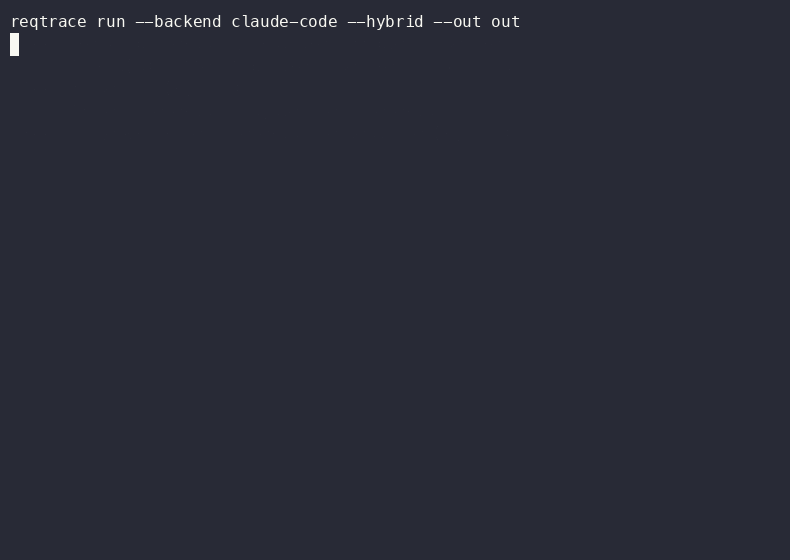
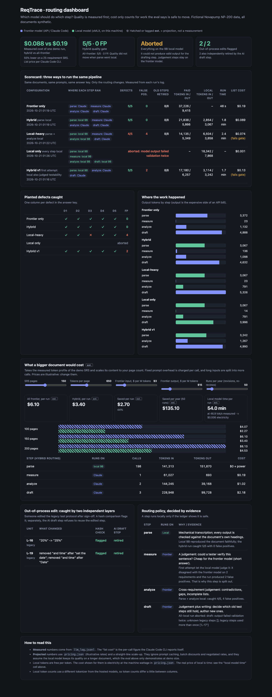
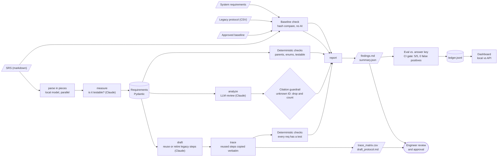

# ReqTrace

[](https://github.com/vladbondarenko97/reqtrace/actions/workflows/ci.yml)

In regulated device development, engineers cross-reference redlined requirements documents against legacy test protocols and trace matrices by hand. It is slow, and the gaps that slip through (a contradiction between two requirements, a behavior nobody wrote a requirement for, a test that traces to nothing) are found late, during physical testing. ReqTrace is a guardrailed AI pipeline that reads a Software Requirements Specification, finds those gaps with cited findings, builds the requirement-to-test trace matrix, and drafts a verification protocol, reusing what still applies from the legacy one. A human engineer reviews and approves everything.



*A real live run of `make demo` (about 1 minute of model time), recorded with asciinema + agg: `docs/demo.cast`.*

## Results

Planted answer key: 5 defects hidden in a 25-requirement synthetic SRS (`data/ground_truth.json`, written before any code). Copied from [`evals/latest_report.md`](evals/latest_report.md), a live run with `parse` on a local 9B model and everything else on Claude:

| What we measured | Result |
|---|---|
| Planted defects caught | **5 / 5** |
| False positives (findings not in the answer key) | **0** |
| Hallucinated citations rejected by the guardrail | 0 |
| Out-of-process edits flagged (baseline drift) | L-16, L-19 |
| Findings from deterministic checks / from the LLM | 4 / 3 |
| Obsolete legacy test steps correctly retired | 8 / 8 |
| Requirements with at least one test step | 25 / 25 |

| Planted defect | Type | Requirements | Caught by |
|---|---|---|---|
| D1 | contradiction | NP-REQ-009, NP-REQ-011 | F-004 (llm) |
| D2 | missing_requirement | NP-REQ-014 | F-008 (llm) |
| D3 | incomplete_enumeration | NP-REQ-001, NP-REQ-024 | F-009 (llm) |
| D4 | untestable | NP-REQ-018 | F-007 (deterministic) |
| D5 | orphan_trace | NP-REQ-025 | F-001 (deterministic) |

The full history, including the failed runs and why, is in [`evals/history.md`](evals/history.md) and [`docs/DECISIONS.md`](docs/DECISIONS.md). Short version: the first run was 4/5, later runs produced false positives because the reviewer found two real gaps I had accidentally left in my own synthetic SRS (I fixed the input, not the answer key), and the first attempt to run more of the pipeline on a small local model failed the gate (next section).

## Which model should do which step?

Reading a 100-200 page SRS and a legacy protocol through a frontier model on every revision adds up, and some organizations cannot send those documents off-site at all. ReqTrace can route steps to a model running on the same machine (oMLX, here a 9B model) and **lets the eval decide what is allowed to move**. Same documents, same prompts, same answer key; only the routing changes ([`docs/dashboard.html`](docs/dashboard.html) shows all of it, with a calculator):

| Configuration | Defects | False pos. | Measured list cost\* | Run time |
|---|---|---|---|---|
| All steps on Claude | 5 / 5 | 0 | $0.195 | 48 s |
| **Parse on the local 9B, rest on Claude** | **5 / 5** | **0** | **$0.088** | 108 s |
| Parse + analyze on the local 9B | 4 / 5 | 4 | $0.073 | 145 s |
| Everything on the local 9B | aborted at the draft step (could not produce valid output, twice) | | n/a | |
| *First hybrid attempt (local also judged testability)* | *5 / 5* | *2* | *$0.126* | *100 s* |

\*Per-call cost as reported by the Claude Code CLI itself, which includes a fixed per-call overhead the raw API would not have. The local model's electricity is about a cent.

What the table says:
- **Transcribing the document is safe to move.** The local model's parse was identical to Claude's on 25 of 25 requirements, field by field.
- **Judgement is not.** The first hybrid attempt let the local model also decide which requirements are testable. It disagreed with Claude on two, producing two false positives, and the eval gate failed it. Testability became its own small step (`measure`) that stays on Claude, and the transcription step stayed local (D-17).
- **Analysis and drafting stay on Claude.** On the 9B model, analysis missed one planted defect and invented four, and drafting failed validation (it reused one legacy step twice) identically on every attempt. Temperature 0 makes local failures repeatable, which also makes them debuggable.
- **A local answer that fails validation is escalated to Claude** instead of failing the run, and the escalation shows up in the log.

Scaling to a bigger document (a **projection**, not a measurement). The demo's measured token profile is scaled to 650 tokens per page; the fixed system prompt is charged per call, long steps are split across calls, and the rates are illustrative ($3 / $15 per million tokens in / out; change them in `src/reqtrace/pricing.json` or in the dashboard):

| SRS size | All on Claude, per run | Parse local, per run | Saved per run | Local model time\*\* |
|---|---|---|---|---|
| 100 pages | $4.07 | $2.27 | $1.80 (44%) | about 36 min |
| 150 pages | $6.10 | $3.40 | $2.70 (44%) | about 54 min |
| 200 pages | $8.13 | $4.53 | $3.60 (44%) | about 72 min |

\*\*At the 47 tokens/s the local model sustained across four parallel pieces on this machine. The savings are real but modest per run: they matter with many documents and many revision cycles, or when the documents cannot leave the building. The trade is time (hours of overnight batch, not seconds) and a quality claim that has only been demonstrated at demo size. Not modeled: prompt caching, batch discounts, negotiated rates.



Open [`docs/dashboard.html`](docs/dashboard.html) in a browser for the scorecard, the per-defect grid, the calculator with sliders for pages, price and runs per year, the drill table, and the routing policy with the evidence behind each choice.

## Try it

```bash
python -m venv .venv && source .venv/bin/activate && pip install -e '.[dev]'
make demo MOCK=1                  # replays recorded responses: no model, no key
make demo                         # live, through your Claude Code login (needs the `claude` CLI; no API key)
make demo HYBRID=1                # parse on a local oMLX model, judgement on Claude
make demo BACKEND=omlx            # everything on the local model (it will not pass; see above)
make demo BACKEND=anthropic       # live, Anthropic API (pip install -e '.[anthropic]', set ANTHROPIC_API_KEY; untested here)
make compare                      # all routings live, scored into evals/ledger.jsonl; rebuilds the dashboard
make dashboard                    # rebuild docs/dashboard.html from the ledger and open it in your browser (make demo ends with this)
```

The local backend reads the oMLX key from `OMLX_API_KEY` or from oMLX's own settings file on your machine. It is never stored in this repo.

Outputs land in `out/`: `findings.md`, `trace_matrix.csv`, `draft_protocol.md`, `summary.json`, `llm_log.jsonl`. A real run is saved in [`docs/sample_output/`](docs/sample_output/).

## Architecture



Every model call goes through one wrapper (`src/reqtrace/llm.py`) that pins the prompt, validates the JSON, retries once, logs, and enforces the token budget. `router.py` decides which backend a step uses and escalates a failing local answer to Claude.

## Guardrails

- **Schema validation:** every model response is parsed into Pydantic models; invalid output gets one retry with the validation error in the prompt, then the run fails loudly. Parsing also cross-checks that the model returned exactly the requirement IDs present in the document.
- **Citation or reject:** an LLM finding must cite requirement IDs that exist in the parsed set. Anything else is dropped and counted as `rejected_findings`. (On this input the live model has not yet cited a nonexistent ID; the rule is proven by a unit test.)
- **Deterministic checks first-class:** parents exist, mode/profile values are in the canonical enum, every requirement has a test, every test traces to a real requirement. No AI involved.
- **Verbatim reuse:** reused legacy steps are copied from the legacy file, not rewritten by the model.
- **Baseline check:** every run compares the requirements and legacy test steps with an approved copy (`data/baseline.json`) and reports each unit that was edited, added or removed (see the next section).
- **Routing is gated by the eval:** a step runs on the local model only if the ledger shows it passes; a local answer that fails validation twice is escalated, and the escalation is logged.
- **Token budget:** `--max-tokens` aborts the run when exceeded (checked before each call).
- **Pinned prompts, full log:** system prompts live in `src/reqtrace/prompts/`; every call is recorded in `out/llm_log.jsonl` (model, tokens, latency, validation pass/fail).
- **Temperature:** the spec asked for temperature 0. Current Claude models reject sampling parameters and the Claude Code CLI has no such flag, so it is not set. Reproducibility comes from recorded fixtures plus repeated live eval runs (see D-03 in DECISIONS).
- **Human-review stamp:** the protocol and findings are stamped "DRAFT — requires engineer review. Not for execution."
- **CI gate:** ruff, pytest, a full `--mock` pipeline run, then the eval; the build fails if recall is below 5/5 or there is any false positive. CI replays recordings, so it protects the pipeline and scoring; it does not re-test the live model.

## Change-control drill

A verification protocol is only as trustworthy as the documents it was built from. As a drill, two values in the legacy protocol were edited after sign-off, the way a well-meaning engineer might do it without knowing the process: L-16 (low-battery alarm threshold 20% → 25%) and L-19 (set date **and time** → date only, plus a typo). Nothing else changed.

Two independent layers caught it, on every live run:

1. **Baseline check (deterministic).** `reqtrace baseline` freezes the approved documents; every run diffs against that copy and emits a high-severity `baseline_drift` finding per edited unit, with the changed words. Line-ending and trailing-newline noise from editors is ignored (the whole CSV shows as changed in git; only two rows differ).
2. **The AI draft step.** It judged both edited steps against the requirements and refused to reuse them: a 25% discharge would not trigger the 20% alarm, and a date-only step no longer covers the date-and-time requirement.

The hash check cannot be argued with and catches edits that look perfectly reasonable; the model explains *why* an edit matters. Neither replaces the other. The drill edit is committed in this repo on purpose, so the baseline keeps flagging it (`tests/` asserts exactly L-16 and L-19).

## What this would look like inside an enterprise

- Swap the model backend (`llm.py`) for the organization's approved enterprise endpoint; the rest of the pipeline only sees validated JSON.
- Put SSO in front of it and write the LLM log to the organization's audit logging.
- Add a connector to the requirements tool so the SRS and trace links are read and written there instead of from files.
- Keep the engineer as the approver: nothing is released without review, and the draft stamp stays.
- Run the planted-defect eval on every prompt or model change, as a regression gate. The same gate decides whether a cheaper or local model may take over a step.
- Keep sensitive documents on-premises: a local model for the mechanical steps means the bulk of the text never leaves the machine.

## Everything here is synthetic

The Novapump NP-200 does not exist. The device, its requirements, the "NP-100" legacy protocol and every identifier were invented for this demo; no real product, company, or document was used as a source.

## Story

[Orchestrator prompt](docs/ORCHESTRATOR_PROMPT.md) → [Plan](docs/PLAN.md) → [Decisions and eval iterations](docs/DECISIONS.md)
