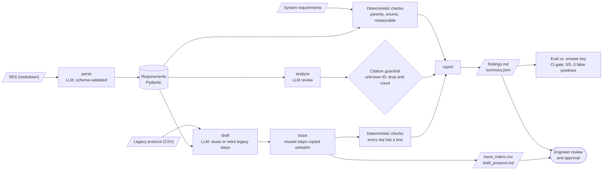

# ReqTrace

[](https://github.com/vladbondarenko97/reqtrace/actions/workflows/ci.yml)

In regulated device development, engineers cross-reference redlined requirements documents against legacy test protocols and trace matrices by hand. It is slow, and the gaps that slip through (a contradiction between two requirements, a behavior nobody wrote a requirement for, a test that traces to nothing) are found late, during physical testing. ReqTrace is a guardrailed AI pipeline that reads a Software Requirements Specification, finds those gaps with cited findings, builds the requirement-to-test trace matrix, and drafts a verification protocol, reusing what still applies from the legacy one. A human engineer reviews and approves everything.


*A real live run of `make demo` (about 1 minute of model time), recorded with asciinema + agg: `docs/demo.cast`.*

## Results

Planted answer key: 5 defects hidden in a 25-requirement synthetic SRS (`data/ground_truth.json`, written before any code). Copied from [`evals/latest_report.md`](evals/latest_report.md):

| What we measured | Result |
|---|---|
| Planted defects caught | **5 / 5** |
| False positives (findings not in the answer key) | **0** |
| Hallucinated citations rejected by the guardrail | 0 |
| Findings from deterministic checks / from the LLM | 2 / 3 |
| Obsolete legacy test steps correctly retired | 8 / 8 |
| Requirements with at least one test step | 25 / 25 |
| Tokens (in / out) | 23,702 / 9,332 |
| Model time | 51.9 s |

| Planted defect | Type | Requirements | Caught by |
|---|---|---|---|
| D1 | contradiction | NP-REQ-009, NP-REQ-011 | F-002 (llm) |
| D2 | missing_requirement | NP-REQ-014 | F-004 (llm) |
| D3 | incomplete_enumeration | NP-REQ-001, NP-REQ-024 | F-005 (llm) |
| D4 | untestable | NP-REQ-018 | F-003 (deterministic) |
| D5 | orphan_trace | NP-REQ-025 | F-001 (deterministic) |

The full history, including the failed runs and why, is in [`evals/history.md`](evals/history.md) and [`docs/DECISIONS.md`](docs/DECISIONS.md). Short version: first run 4/5, and later runs produced false positives because the reviewer found two real gaps I had accidentally left in my own synthetic SRS. I fixed the input, not the answer key.

## Try it

```bash
python -m venv .venv && source .venv/bin/activate && pip install -e '.[dev]'
make demo MOCK=1                  # replays recorded responses: no model, no key
make demo                         # live, through your Claude Code login (needs the `claude` CLI; no API key)
make demo BACKEND=anthropic       # live, Anthropic API (pip install -e '.[anthropic]', set ANTHROPIC_API_KEY; untested here)
```

Outputs land in `out/`: `findings.md`, `trace_matrix.csv`, `draft_protocol.md`, `summary.json`, `llm_log.jsonl`. A real run is saved in [`docs/sample_output/`](docs/sample_output/).

## Architecture



Every LLM box goes through one wrapper (`src/reqtrace/llm.py`) that pins the prompt, validates the JSON, retries once, logs, and enforces the token budget.

## Guardrails

- **Schema validation:** every model response is parsed into Pydantic models; invalid output gets one retry with the validation error in the prompt, then the run fails loudly. Parsing also cross-checks that the model returned exactly the requirement IDs present in the document.
- **Citation or reject:** an LLM finding must cite requirement IDs that exist in the parsed set. Anything else is dropped and counted as `rejected_findings`. (On this input the live model has not yet cited a nonexistent ID; the rule is proven by a unit test.)
- **Deterministic checks first-class:** parents exist, mode/profile values are in the canonical enum, every requirement has a test, every test traces to a real requirement. No AI involved.
- **Verbatim reuse:** reused legacy steps are copied from the legacy file, not rewritten by the model.
- **Token budget:** `--max-tokens` aborts the run when exceeded (checked before each call).
- **Pinned prompts, full log:** system prompts live in `src/reqtrace/prompts/`; every call is recorded in `out/llm_log.jsonl` (model, tokens, latency, validation pass/fail).
- **Temperature:** the spec asked for temperature 0. Current Claude models reject sampling parameters and the Claude Code CLI has no such flag, so it is not set. Reproducibility comes from recorded fixtures plus repeated live eval runs (see D-03 in DECISIONS).
- **Human-review stamp:** the protocol and findings are stamped "DRAFT — requires engineer review. Not for execution."
- **CI gate:** ruff, pytest, a full `--mock` pipeline run, then the eval; the build fails if recall is below 5/5 or there is any false positive. CI replays recordings, so it protects the pipeline and scoring; it does not re-test the live model.

## What this would look like inside an enterprise

- Swap the model backend (`llm.py`) for the organization's approved enterprise endpoint; the rest of the pipeline only sees validated JSON.
- Put SSO in front of it and write the LLM log to the organization's audit logging.
- Add a connector to the requirements tool so the SRS and trace links are read and written there instead of from files.
- Keep the engineer as the approver: nothing is released without review, and the draft stamp stays.
- Run the planted-defect eval on every prompt or model change, as a regression gate.

## Everything here is synthetic

The Novapump NP-200 does not exist. The device, its requirements, the "NP-100" legacy protocol and every identifier were invented for this demo; no real product, company, or document was used as a source.

## Story

[Orchestrator prompt](docs/ORCHESTRATOR_PROMPT.md) → [Plan](docs/PLAN.md) → [Decisions and eval iterations](docs/DECISIONS.md)
